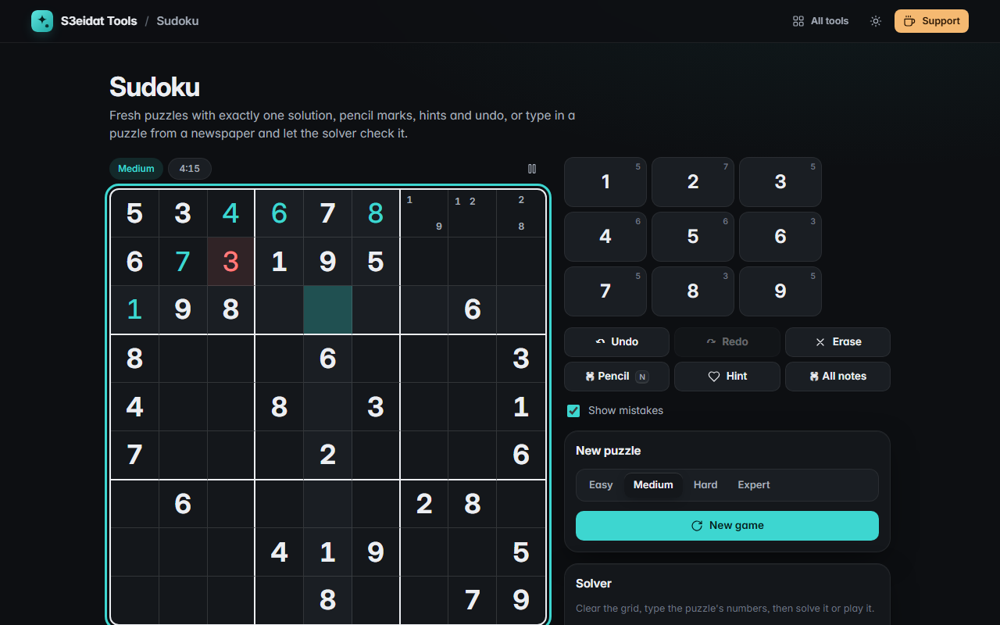

# Sudoku

> Play, generate and solve Sudoku. Free, private, and it runs entirely in your browser.

### ▶ [Open Sudoku](https://s3eidat.github.io/sudoku/)



## Features

- **Play** with mouse, touch or keyboard (arrows, 1–9, <kbd>Del</kbd>), with a number pad that shows how many of each digit are left
- **Pencil marks** (pencil mode or <kbd>Shift</kbd>+digit), "all notes" to fill candidates, and notes that clear themselves when you place a digit
- **Undo / redo**, **same-number highlight**, row/column/box highlight
- **Show mistakes** toggle (wrong digits and clashes in red), **hints** that fill the selected cell or the most constrained one, **timer** with pause
- **New puzzles in four levels**: Easy and Medium are solvable with singles only (no guessing); Hard and Expert have fewer clues. Every puzzle is checked to have **exactly one solution**
- **Solver** for a puzzle you type in or paste as 81 digits: constraint propagation with most-constrained-cell backtracking; it reports **no solution**, **exactly one**, or **more than one**, and lets you play a valid puzzle
- **Progress saved** in this browser, so you can close the tab and carry on later

## Privacy

Everything happens on your device. There is no server, no account, no analytics.
The page ships with a strict Content-Security-Policy (`connect-src 'self'`), so the browser
itself blocks any attempt to send data anywhere.

## Run it yourself

It's plain HTML, CSS and JavaScript with no build step:

```bash
git clone https://github.com/s3eidat/sudoku
cd sudoku
python -m http.server 8000
```

Then open http://localhost:8000.

## Support

If this saved you time, **[buy me a coffee ☕](https://s3eidat.github.io/coffee/)**. It keeps every tool free.

---

Part of **[S3eidat Tools](https://s3eidat.github.io/)**: 100+ free, private tools that run in your browser. MIT licensed.
